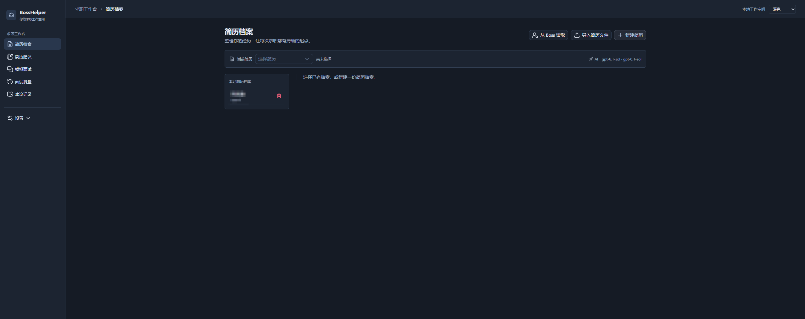
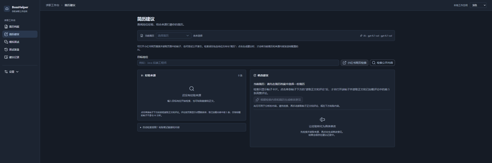
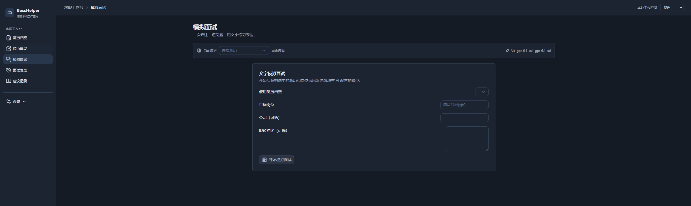
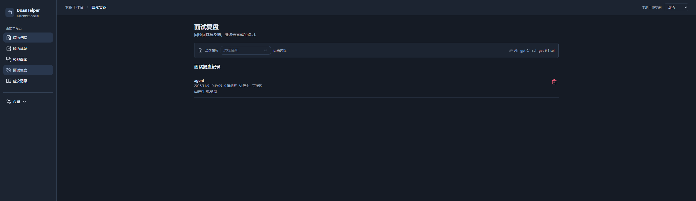
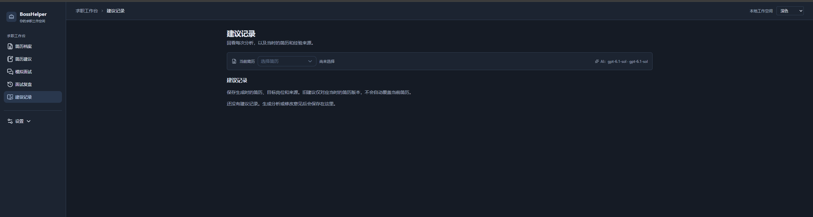
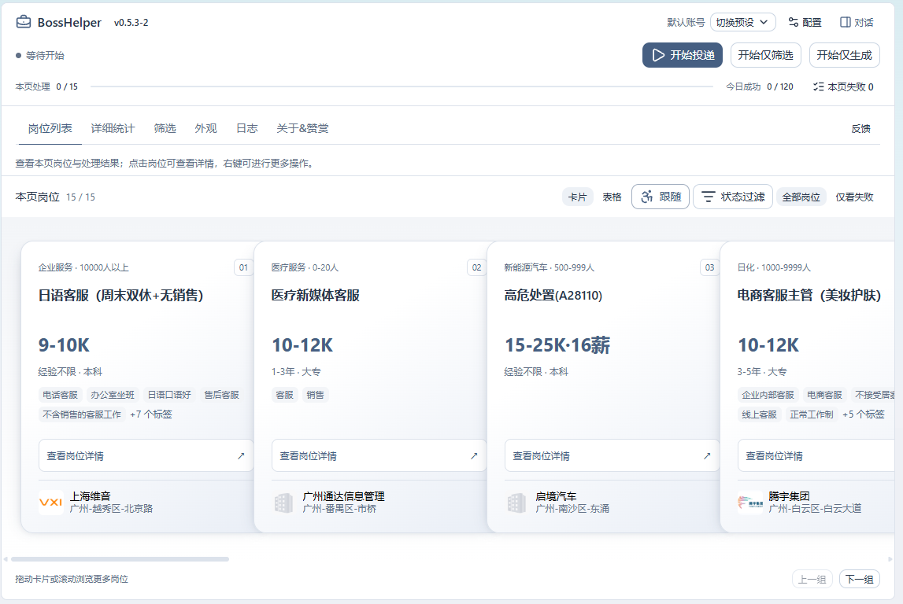

# BossHelper · 求职工作台

把简历整理、经验检索、面试练习和岗位投递放进同一个浏览器扩展，让每一次求职准备都有可回看的依据。

BossHelper 在原有 Boss 直聘投递助手的基础上，新增了围绕个人简历的求职工作台：从 Boss 资料或简历文件建立档案，结合小红书岗位经验生成修改建议，再通过逐题文字面试和复盘持续练习。所有 AI 功能共用已有模型配置，简历、建议和面试记录在本地管理。

## 我们做了哪些改进

| 改进方向 | 当前能力 | 带来的变化 |
| --- | --- | --- |
| 从投递走向完整求职准备 | 简历档案、简历建议、模拟面试、面试复盘、建议记录 | 以同一份简历串起准备、练习和投递流程 |
| 让修改建议有来源 | 按目标岗位检索小红书内容，手动读取正文和高赞评论，保留作者与原文链接 | 可以对照简历原文与经验来源检查建议 |
| 让面试练习可以持续 | 逐题文字问答、回答草稿保存、刷新后继续、结束后生成复盘 | 从一次性问答变成可回看的练习记录 |
| 让历史结果保留上下文 | 建议和面试保存当时的简历快照、目标岗位等信息 | 后续修改简历时，仍能理解旧建议与旧回答的依据 |
| 统一工作台与投递体验 | 雾蓝灰主题、清晰导航、浅色与深色模式、横向层叠岗位卡片 | 常用任务更集中，岗位浏览和操作状态更清楚 |
| 提升使用稳定性 | 保存应答兼容、并发写入检查、失败重试、部分结果保留、AI 响应兼容处理 | 减少保存异常和中断带来的重复操作 |

## 核心功能

### 简历档案

- 支持导入 PDF、DOCX、TXT，也可以打开已登录的 Boss 个人简历页，读取页面当前可见的资料。
- 导入后先预览、编辑和确认，再保存为本地档案；已有档案可以继续维护或删除。
- 显示当前简历和未保存状态，避免切换页面时丢失正在编辑的内容。
- 文件文字提取与字段识别在本地完成；扫描版 PDF 和旧版 DOC 需要先转成可读取格式。

### 有来源的简历修改建议

输入目标岗位后，可以打开小红书网页检索，也可以尝试检索公开内容。搜索结果展示笔记卡片；点击单条笔记的“读取正文和评论”后，再读取该帖内容及本次加载评论中的高赞观点。

生成建议时，AI 结合目标岗位、当前简历和已读取的来源，围绕简历原文、存在的问题、来源依据、建议改写和待补充信息给出修改意见，并区分笔记作者与评论者的观点。只有标题的结果不参与有来源的建议生成。

访问受限时可以粘贴链接和正文补充来源。页面还保留“仅分析简历”的可选入口；生成过程支持实时显示、主动停止和保留部分结果。

### 文字模拟面试与复盘

选择简历和目标岗位，可补充公司及职位描述。开始后按题练习，集中查看当前问题并输入回答，历史问答按需展开。

问题、回答与草稿保存在本地，刷新后可以从面试记录继续。结束后生成逐题反馈、整体亮点、待改进点、示范回答和行动清单。每次面试保留开始时的简历快照，方便回顾当时的准备情况。

### 建议记录

保存分析时使用的简历版本、目标岗位、模型、经验来源和生成结果。记录可以回看、标记已处理或删除；中断结果会标注不完整，旧建议不会自动覆盖当前简历。保存失败时可以重试，或导出尚未保存的建议。

### Boss 岗位筛选与投递

保留原有岗位筛选、AI 筛选、招呼语生成、预设切换和投递能力，并重新组织了操作界面：

- 顶部常驻开始／暂停、本页进度、今日成功和本页失败数量，点击失败数量可查看对应岗位。
- 岗位采用横向层叠卡片，支持鼠标拖动、滚轮、触摸滑动、左右按钮和方向键，也可切换表格。
- 卡片突出岗位、薪资、经验、学历和公司信息；技能标签可展开，岗位详情有独立入口。
- 悬停时卡片抬升、轻微倾斜，相邻卡片让位；拖动时冻结动画，兼容窄屏、深色模式和系统减少动态效果设置。
- 筛选、统计和日志按需查看，保留自动跟随、状态过滤及右键操作。

## 项目预览

以下为当前版本的实际界面。

### 简历档案



### 简历建议



### 模拟面试



### 面试复盘



### 建议记录



### Boss 投递面板



## 安装与启动

当前版本可从源码构建并加载到 Chrome。准备好 Git、Node.js 和 Bun 后，在终端执行：

```sh
git clone --recurse-submodules https://github.com/caotamyenmovo/BossHelper.git
cd BossHelper
bun install
bun run build:chrome
```

已有仓库先运行 `git submodule update --init --recursive`。项目保存了 devlog-ui 的环境类型补丁，安装依赖、类型检查和构建前会自动应用。

1. 打开 `chrome://extensions`，启用开发者模式。
2. 点击“加载已解压的扩展程序”，选择项目中的 `.output/chrome-mv3` 文件夹。
3. 从扩展的“选项”或 Boss 面板中的“配置”进入工作台。
4. 在“设置 → AI 模型配置”中配置并确认模型可用，再导入简历开始使用。

更新后重新构建并在扩展管理页点击“重新加载”，同时刷新已打开的工作台、Boss 和小红书页面。

## 推荐使用流程

1. **建立档案**：导入简历文件或从 Boss 读取资料，核对内容后保存。
2. **确定方向**：选择当前简历，填写目标岗位。
3. **收集经验**：检索小红书笔记，选择有价值的帖子读取正文和评论。
4. **修改简历**：点击生成修改意见，对照来源核查建议，再编辑自己的简历。
5. **练习面试**：补充目标公司或职位描述，逐题回答，结束后查看复盘。
6. **筛选与投递**：回到 Boss 页面选择预设，检查条件后开始投递，并查看进度和失败原因。

## AI 与数据

简历分析、建议生成和模拟面试统一复用扩展现有的 AI 模型配置，无需分别设置。简历导入不会自动调用 AI；点击分析、生成建议或开始面试等操作后，相关简历、岗位、来源或问答文本才会发送到所配置的模型服务。

简历档案、建议与面试记录保存在浏览器扩展本地存储，可分别删除。它们不会随 GitHub 源码上传，也不会自动同步到其他电脑。更换浏览器配置、移除扩展或清理扩展数据前，请自行保留需要的内容。

Boss 资料读取依赖登录状态及页面结构；小红书内容读取依赖网站权限和实际访问情况。遇到登录或验证需在网站页面完成，也可使用文件导入或粘贴内容继续。高赞评论仅从本次已加载且点赞数可读的评论中选取前 5 条，不代表全帖排名。

## 开发与验证

技术栈：WXT、Vue 3、TypeScript、Nuxt UI 4、Tailwind CSS 4，以及用于模型接入的 AI SDK。

```sh
# 本地开发
bun run dev

# 类型检查与逻辑测试
bun run check
bun test ./scripts/

# Chrome 生产构建
bun run build:chrome

# 使用构建后的扩展检查工作台与投递布局
node scripts/ui-layout-browser.mjs
node scripts/delivery-layout-browser.mjs
```

浏览器验证使用隔离配置、模拟网站与本地 AI 响应，覆盖简历导入、建议保存、面试恢复、错误处理、主题和窄屏布局；投递流程使用模拟动作。真实账号下的网站访问、资料读取与投递效果仍取决于对应页面和环境。

## 项目基础与许可

本项目基于 Ocyss 的 Boss 直聘助手继续开发，重点新增求职工作台、简历经验建议、文字面试与复盘，并重构界面和完善保存、恢复及 AI 兼容处理。原作者版权声明与 MIT 许可保留于 [LICENSE](LICENSE)。
